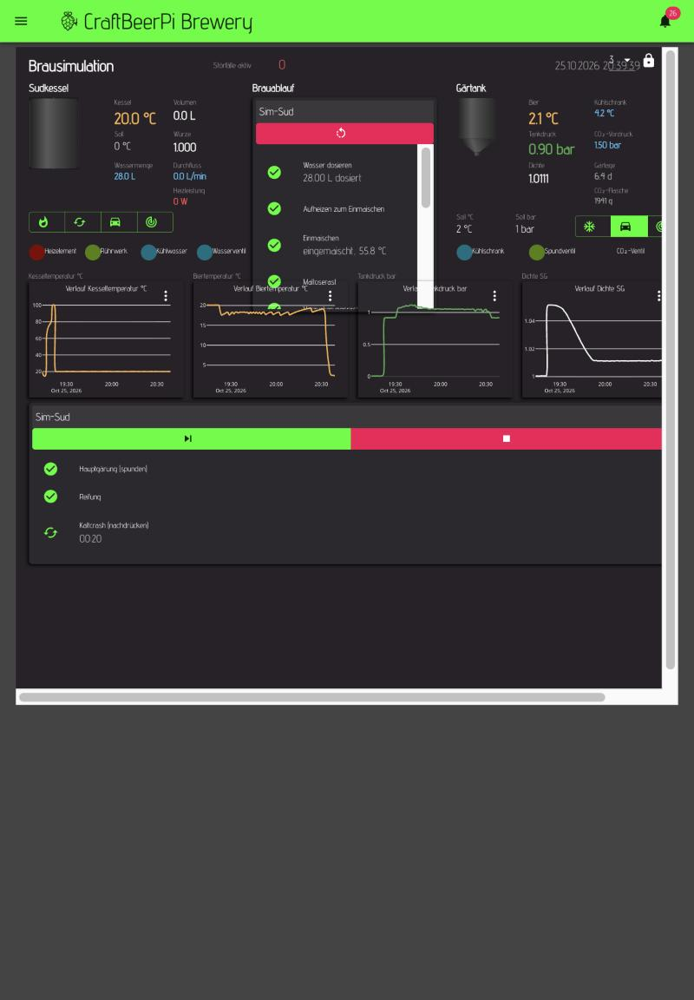

# cbpi4-simulation

CraftBeerPi4-Plugin, das den **ganzen Brautag ohne Hardware** nachbildet: Wasser dosieren, Aufheizen,
Maischrasten, Kochen, Abkühlen, Anstellen, Gärung mit Druckaufbau, Spunden/Nachdrücken, Kaltcrash. Die Werte
hängen physikalisch zusammen (Heizung erwärmt den Kessel, der Kühlschrank kühlt das Bier, die Gärung erzeugt CO₂
und senkt die Dichte, Ventile ändern den Druck, beim Kaltcrash zieht das kalte Bier CO₂ aus dem Kopfraum).

Geregelt wird mit den **echten Plugins**: `SicherAktor`, `SicherHysterese` (cbpi4-brausicher), `GaerDruckLogik`
(cbpi4-gaerdruck), `VentilDosierer`/`WasserDosieren` (cbpi4-ventil) und den eingebauten Maisch-, Koch-, Kühl- und
Gärschritten. Störfälle lassen sich auslösen, damit man deren Schutzfunktionen prüfen kann.

| In CraftBeerPi | Typ | Aufgabe |
|---|---|---|
| `BrauSimulation` | Fühler | alle Parameter, Rollen der Aktoren, Aktionen (anlegen, Störfälle, Ereignisse, Prüfung); Wert = Zahl aktiver Störfälle |
| `SimFuehler` | Fühler | eine Messgröße aus dem Modell, nie `None`, kennt sein Alter; Unterklasse von `SicherFuehler`, damit der Heizschutz greift |
| `SimAktor` | Aktor | einfacher Aktor für Rollen ohne echtes Plugin (nur ohne cbpi4-brausicher nötig) |
| `SimEreignis` | Schritt | Wasser einfüllen, Einmaischen, Treber ziehen, Anstellen (startet auf Wunsch den Gärplan) |
| `SimulationsTakt` | Erweiterung | rechnet das Modell alle 0,1 s fort und sichert den Stand (`simulation_zustand.json`) |

## Einrichten – alles im Browser

Voraussetzung: das Plugin ist installiert (Abschnitt Einbau), cbpi neu gestartet.

1. **Hardware → Sensor → +**: Name `Brausimulation`, Typ **BrauSimulation**, speichern.
2. In der Liste beim Fühler auf das **Augen-Symbol** (Bearbeiten), Parameter nach Wunsch ändern (Zeitraffer,
   Heizleistung, Volumen …), **„Beim Speichern anlegen“ = Ja**, speichern.
   Angelegt werden 13 Fühler, 8 Aktoren (simuliert), „Sudkessel (Sim)“, „FermZilla (Sim)“, der Maischplan
   „Sim-Sud“, der Gärplan und **Dashboard 3**. Danach steht die Einstellung wieder auf „Nein“.
3. **Dashboard → oben rechts 3**. Brauen starten: **Brauen → ▶**. Der Tag läuft bis zum Kaltcrash von selbst durch;
   „Anstellen“ startet den Gärplan.
4. Alle weiteren Aktionen: im Dashboard der **Knopf ⋮ neben „Störfälle aktiv“** (Störfall auslösen/aufheben,
   Störfälle prüfen, Ereignisse, Simulation neu anlegen, Kessel leeren, Alles zurücksetzen). Neben Kessel-, Bier-,
   Tankdruck- und Vordruckwert öffnet ⋮ den Fühlerausfall dieses einen Fühlers.

### Noch einmal von vorn

| Aktion | wirkt auf |
|---|---|
| **Kessel leeren (Gärtank bleibt)** | nur den Kessel: Inhalt, Malz und Extrakt auf 0, Kessel auf Raumtemperatur, **Wasserzähler auf 0**. Gärtank, Störfälle und CO₂-Flasche bleiben, wie sie sind |
| **Anstellen (Würze in den Gärtank)** | schiebt die Würze aus dem Kessel in den Gärtank – der Kessel ist danach leer, der Gärtank voll |
| **Alles zurücksetzen** | das ganze Modell: Kessel *und* Gärtank leer, Flasche voll, alle Störfälle weg |

„Kessel leeren“ ist für den nächsten Versuch am Brautag, ohne die laufende Gärung wegzuwerfen.

Parameter ändern wirkt sofort (beim nächsten Takt). Nach einer Änderung des Zeitraffers „Simulation anlegen“ erneut
ausführen, damit die Zeiten im Maisch- und Gärplan passen.

Wer lieber die Kommandozeile nimmt (nur Standardbibliothek, ohne cbpi im Python):

```bash
python3 einrichten.py --url http://127.0.0.1:8000 --zeitraffer-brauen 60 --zeitraffer-gaerung 120
python3 stoerfaelle.py --url http://127.0.0.1:8000 --log ~/cbpi4/logs/cbpi.log
```

**Sicherheit:** Die Simulation in einer **eigenen cbpi-Instanz** betreiben (eigener Konfigordner, nur an 127.0.0.1),
nicht im cbpi, das die echte Brauerei steuert. Das Anlegen bricht ab, wenn es einen gleichnamigen *nicht*
simulierten Aktor oder Fühler findet, und die simulierten Aktoren liegen auf GPIOs, die der HAT nicht belegt
(5, 7, 8, 12, 14, 15, 23, 24, 25; Stand Platine Biersteuerung f5a2bcf), damit
`SicherAktor` keinen doppelten GPIO meldet – trotzdem ersetzt „Simulation anlegen“ den Maischplan von cbpi.
Mit dem Dampfkondensator sind diese neun Pins **vollständig vergeben**: Ein weiterer simulierter Aktor braucht
erst einen frei gewordenen.

## Rührwerk und Dampfkondensator laufen über Rezeptschritte

cbpi 4.7.7 schaltet den Rührwerksausgang eines Kessels **nirgends selbst** – weder die eingebaute `Hysteresis`
noch `SicherHysterese` fassen `kettle.agitator` an. Beides steht deshalb als `ToggleStep` im Maischplan;
`ToggleStep` schaltet einmal und geht weiter, der Ausgang bleibt über alle folgenden Schritte stehen.

| Schritt | Wirkung |
|---|---|
| **Rührwerk ein** | vor „Aufheizen zum Einmaischen“, läuft über alle Rasten |
| **Rührwerk aus** | direkt nach „Abmaischen“ |
| **Aufheizen auf 80 °C** | `MashStep` ohne Timer: endet genau an der Schwelle (`DAMPF_AB_C`) |
| **Dampfkondensator ein** | unmittelbar danach, also ab 80 °C |
| **Dampfkondensator aus** | direkt nach „Kochen“ |

Während der Maische wird die Schwelle nie erreicht (Abmaischen bei 78 °C), der Kondensator bleibt dort also aus.
Gemessen im Durchlauf: Rührwerk 230 s durchgehend von „Rührwerk ein“ bis „Rührwerk aus“, Dampfkondensator ab
80,6 °C (höchster Wert davor 78,6 °C) bis vor dem Abkühlen.

**Wird der Brautag mitten in der Maische gestoppt, bleibt das Rührwerk an.** Der Wächter des `SicherAktor`
schaltet nur ab, wenn cbpi hängt, nicht bei einem bewusst eingeschalteten Ausgang. Von Hand über den Knopf im
Dashboard ausschalten.

## Was das Modell rechnet

**Kessel:** Wärmekapazität aus Wasser, Extrakt, Malz (1700 J/kg K) und Topf (3000 J/K); Heizleistung × tatsächlicher
Ausgang minus Verlust an den Raum; am Siedepunkt verdampft die überschüssige Energie (2,26 MJ/kg). Wasser kommt mit
Leitungstemperatur dazu, das Malz beim Einmaischen mit Raumtemperatur (Temperatursturz um etwa 3 K). Zwischen 50
und 80 °C lösen die Enzyme Extrakt (am schnellsten 62–72 °C); Treber ziehen nimmt 0,8 L/kg Würze mit. Der
Würzekühler zieht `Würzekühler W/K × (T − Kühlwasser)`. Der Kesselfühler sitzt träge im Tauchrohr (20 s).

**Gärtank:** Bier und Kühlschrankluft als zwei Wärmespeicher; der Verdampfer kommt nicht unter −5 °C. Die Hefe wächst
logistisch, die Gärrate hängt von der Temperatur ab (unter 4 °C steht sie, 18 °C = 1). Verbrauchter Extrakt → Dichte
(scheinbarer Vergärungsgrad), CO₂ (aus dem Alkohol nach (OG−FG)·131,25) und Gärwärme (1,2 kJ/g CO₂). CO₂ löst sich
nach Henry (3,35 g/L·bar bei 0 °C, 1,7 bei 20 °C): Ruhendes Bier sättigt in etwa einer Woche, Gärblasen treiben
übersättigtes CO₂ kräftig aus. Der Kopfraum ist Gärtank-Volumen minus Bier, Druck nach p = nRT/V.

**Gaswege (wie am FermZilla):** ein Gaspfosten, dahinter 50 mL Leitung mit Tankfühler, Spundventil und CO₂-Ventil
(Leitwerte 1,5 bzw. 1,0 Normliter/s je bar), Druckminderer mit Vordruck, Flasche mit Inhalt, mechanisches
Überdruckventil am Deckel (2,4 bar). Verstopft der Pfosten, sieht der Fühler nur noch die kleine Leitung.

**Wasser:** Ist das Wasserventil ein `VentilDosierer` in Simulation, liest das Modell dessen gezählte Impulse und
stellt dessen Durchfluss ein – dosiert wird also vom echten Regler (Anlauf-, Kein-Fluss-, Mengengrenzen).

### Zeitraffer

Langsame Vorgänge (Wärme, Verdampfen, Maische, Gärung, CO₂ im Bier) laufen beschleunigt, **Wasser- und Gasflüsse in
Echtzeit**: Die echten Plugins messen Durchfluss und Ventilpulse in Echtzeit, ein 0,3-s-Puls würde im Zeitraffer zu
Minuten. Folgen, die „Simulation anlegen“ schon berücksichtigt:

- Timer in cbpi laufen in Echtzeit und kennen nur ganze Minuten: Plan-Zeiten = Simulationszeit / Zeitraffer,
  mindestens 1 min (bei Zeitraffer 60 dauert jede Rast mindestens 60 Simulationsminuten).
- GaerDruckLogik bekommt `Pause s` = 1 und `Kompressorpause min` = 5 min / Zeitraffer. Mit 3 s Pause kommt das
  Spunden bei Zeitraffer 120 nicht gegen die beschleunigte Gärung an, und die Wirkungsprüfungen melden fälschlich
  „Nachdrücken ohne Wirkung“ / „Spunden ohne Wirkung“ (in Echtzeit nachgerechnet: dort passiert das nicht).
- Über Zeitraffer Gärung ~200 reicht auch das nicht mehr.

## Parameter (Fühler „Brausimulation“)

| Parameter | Vorgabe | |
|---|---|---|
| Zeitraffer Brauen / Gärung | 60 / 120 | 1 min/s bzw. 1 Tag in 12 min |
| Raumtemperatur, Leitungswasser, Kühlwasser °C | 20 / 12 / 12 | |
| Durchfluss L/min | 12 | Wasserhahn, Echtzeit |
| Heizleistung W, Wärmeverlust Kessel W/K | 3500 / 6 | |
| Würzekühler W/K | 120 | 23 L von 100 auf 20 °C in gut 30 min |
| Siedepunkt °C | 100 | |
| Schüttung kg, Ausbeute % | 5,5 / 72 | 28 L → etwa 12 °P vor dem Kochen |
| Gärtank L | 35 | FermZilla 30 L All Rounder gesamt |
| Würze L / Stammwürze °P ohne Brautag | 23 / 12 | für „Anstellen“ mit leerem Kessel |
| Vergärungsgrad %, Gärrate | 78 / 1 | Hauptgärung etwa 3 Tage bei 18 °C |
| Kälteleistung W, Wärmeverlust Kühlschrank W/K, Heizung Gärtank W | 120 / 1,5 / 40 | |
| CO₂-Vordruck bar, CO₂-Flasche g, CO₂-Flasche L | 1,5 / 2000 / 2,7 | Inhalt und Innenvolumen der Flasche |
| Überdruckventil bar | 2,4 | |
| Rauschen | 1 | 0 = Messwerte ohne Rauschen |

## Messgrößen (`SimFuehler`)

Kesseltemperatur °C, Kesselvolumen L, Würze Kessel SG, Durchfluss L/min, Wassermenge L, Heizleistung W (was
wirklich heizt – über REST sieht man bei SicherAktor nur den Wunsch), Biertemperatur °C, Kühlschrank (Luft) °C,
Tankdruck bar (in der Leitung), CO₂-Vordruck bar, Dichte SG, **CO₂-Flasche bar**, Gärtage d.

## Flaschendruck statt Füllstand

Die Messgröße **CO₂-Flasche** liefert **bar** – denselben Wert wie am Brau-Pi der Drucksensor vor dem
Druckminderer (Druck 5, J21/0x49 AIN0). Gerechnet wird der Dampfdruck von CO₂ nach Span/Wagner:

| Temperatur | Flaschendruck (Überdruck) |
|---|---|
| 10 °C | 44,0 bar |
| 15 °C | 49,9 bar |
| 20 °C | 56,3 bar |
| 25 °C | 63,3 bar |
| 30 °C | 71,1 bar |

**Der Druck hängt nicht am Füllstand.** In der Flasche steht flüssiges CO₂ unter seinem eigenen Dampfdruck;
der richtet sich allein nach der Temperatur. Eine 2-kg-Flasche zeigt von 2000 g bis etwa 500 g denselben
Wert und fällt erst, wenn die letzte Flüssigkeit verdampft ist – dann aber schnell:

| Inhalt (2,7 L Flasche, 20 °C) | Druck |
|---|---|
| 2000 g … 500 g | 56,3 bar |
| 200 g | 40,0 bar |
| 50 g | 9,2 bar |
| 10 g | 1,0 bar |

Der Geber ist also eine Warnung „gleich leer“, keine Restmengenanzeige. Wie schnell er fällt, bestimmt
`CO₂-Flasche L` (Innenvolumen); der Inhalt steht in `CO₂-Flasche g`.

## Störfälle

| Störfall | Erwartete Reaktion | Geprüft (`stoerfaelle.py`) |
|---|---|---|
| Fühlerausfall Kesseltemperatur | SicherAktor sperrt nach „Max Alter s“, Meldung; heizt wieder, sobald der Fühler liefert | ja |
| Übertemperatur (Kessel trocken) | SicherAktor sperrt bei 105 °C und bleibt gesperrt bis „Schutz zurücksetzen“ | ja |
| Heizungsrelais klebt | heizt trotz Aus – **keine Software fängt das ab**, Temperaturbegrenzer/Schütz nötig | ja |
| Kein Wasser (Hahn zu) | VentilDosierer schließt nach der Anlaufzeit („Kein Durchfluss nach 5 s“) | ja |
| Fühlerausfall Tankdruck | GaerDruckLogik: „Tankdruck unbekannt“, Spundventil pulst, nie Drücken | ja |
| CO₂-Flasche leer | Vordruck 0 und Flaschendruck 0: „CO₂-Vordruck zu niedrig“, kein Nachdrücken | ja |
| Gaspfosten verstopft | „Druck springt … Gasweg zum Tank verstopft“; im Tank bläst das Überdruckventil ab | ja |
| Fühlerausfall Biertemperatur | GaerDruckLogik schaltet Heizung und Kühlung ab (nach 30 s) | ja |
| Fühlerausfall CO₂-Vordruck | „CO₂-Vordruck unbekannt“, Nachdrücken ausgesetzt | nur auslösbar |
| Kühlung defekt | Kühlschrankluft wird trotz laufender Kühlung wärmer; **GaerDruckLogik meldet nichts** | ja |

## Einbau

```bash
cd ~ && git clone https://github.com/timmkueck/cbpi4-simulation.git
~/cbpi4-venv/bin/pip install ~/cbpi4-simulation
sudo systemctl restart craftbeerpi
```

Ohne cbpi4-brausicher, -gaerdruck oder -ventil geht es auch (SimAktor statt SicherAktor, Wasser per Ereignis,
Gärtank mit FermenterHysteresis), dann prüft man aber deren Schutzfunktionen nicht. Beim Entwickeln mit
`pip install -e` den Kompatibilitätsmodus nehmen (`--config-settings editable_mode=compat`): cbpi findet Plugins über
`pkgutil.iter_modules`, das die neuen editierbaren Installationen nicht sieht.

## Tests

```bash
pip install cbpi4 pytest
python -m pytest tests/ -q
```

37 Tests: Aufheizen, Fühlerträgheit, Sieden und Verdampfen, Einmaischen und Extrakt, Würzekühler, Kessel trocken,
Relais klebt, Wasser (eigen und über den VentilDosierer-Zähler), Anstellen, Gärung (Dichte, Druck, Überdruckventil,
Temperaturabhängigkeit, Gärwärme), Spund- und CO₂-Ventil, CO₂ leer, verstopfter Pfosten, Kaltcrash, Zeitraffer,
Sichern/Laden; gegen die echten Plugins: Druckregler von cbpi4-gaerdruck hält 1 bar über Anstellen, Gärung und
Störfälle, Heizschutz und Fühlerausfall mit echtem SicherAktor, Neustart der SicherHysterese, Aktionen.

## Nachweis im echten CraftBeerPi 4.7.7

Am 25.10.2026 auf dem Mac (eigene Instanz, Konfigordner nur für die Simulation, gebunden an 127.0.0.1), mit
cbpi4-brausicher, -gaerdruck und -ventil, Zeitraffer 60/120. **Eingerichtet und gestartet nur im Browser**: Fühler
„Brausimulation“ angelegt, „Beim Speichern anlegen = Ja“, Brauen → ▶. Danach lief alles ohne Eingriff:

| Echtzeit | Schritt | Ergebnis |
|---|---|---|
| 19:14–19:17 | Wasser dosieren (WasserDosieren + VentilDosierer) | 28,00 L bei 12 L/min, Kessel kühlt auf 14 °C |
| 19:17 | Aufheizen, Einmaischen | 57 °C erreicht, Malz kühlt die Maische auf 55,8 °C |
| 19:17–19:21 | Maltose-, Verzuckerungsrast, Abmaischen | 63 / 72 / 78 °C, Würze SG 1,050 |
| 19:21–19:22 | Treber ziehen, Kochen | 23,6 L, siedet bei 100 °C |
| 19:22–19:23 | Abkühlen (CooldownStep mit Kühlwasser) | 99 → 19 °C in gut 35 s (35 Simulationsminuten) |
| 19:23 | Anstellen (SimEreignis startet den Gärplan) | 22,1 L, 12,6 °P (SG 1,051), 18,4 °C |
| 19:23–20:11 | Hauptgärung 18 °C, Soll 1,0 bar | SG 1,051 → 1,011, Druck zu 98 % zwischen 0,85 und 1,10 bar (Spitze 1,12) |
| 20:11–20:32 | Reifung 19 °C | Druck 0,97–1,05 bar |
| 20:32–21:00 | Kaltcrash 2 °C | Bier 19 → 2 °C, Druck 0,89–1,01 bar, 37 g CO₂ nachgedrückt |

Im Log von cbpi stand während des ganzen Tags **keine einzige Warnung** eines Plugins. Belege: Verlauf aller Werte
alle 5 s (CSV), die Sensorlogs von cbpi und Screenshots des Dashboards:



Störfallprüfung in einer zweiten Instanz, ausgelöst im Browser (Dashboard → ⋮ → „Störfälle prüfen“, Ergebnisse als
Meldungen) und über `stoerfaelle.py`: **15 von 15 Prüfungen bestanden** (Tabelle „Störfälle“).

## Was die Simulation in anderen Teilen gefunden hat

- **SicherHysterese startete ab der zweiten Rast nicht mehr** (cbpi4-brausicher): cbpi stoppt die Kessellogik am
  Ende jedes Schritts nur über `state`; ohne `running = False` verweigert der nächste Schritt den Start („already
  running“), der Kessel kühlt aus. Behoben (eine Zeile), Regressionstest hier.
- **`POST /kettle/{id}/off` liefert in cbpi 4.7.7 HTTP 500** (die Methode fehlt im Kettle-Controller). Ausschalten
  geht nur über `toggle`.
- **Kochen mit BoilStep 99 °C und Hysterese simmert nur**: Die Kessellogik schaltet bei 99 °C ab, verdampft wurden in
  „60 min“ nur 0,5 L statt gut 5 L. Für sprudelndes Kochen braucht es mehr Soll oder volle Leistung.
- **GaerDruckLogik drückt nur bis Soll − 0,10 bar nach**, nicht auf Soll; im Kaltcrash steht der Tank bei 0,90 bar.
- **Wirkungsprüfung von GaerDruckLogik**: nimmt den Druck beim ersten Puls als Ausgangswert. Ist der Fühlerwert in dem
  Moment veraltet und war höher (nach „Zurücksetzen“ der Simulation), sperrt sie das Nachdrücken fälschlich; ebenso
  bei einem einfrierenden Fühler, bevor er als ausgefallen gilt (dann zu Recht).
- **Kühlung defekt bleibt unbemerkt**: GaerDruckLogik meldet nichts, wenn das Bier trotz laufender Kühlung wärmer wird.
- **Relais klebt** fängt keine Software ab – Temperaturbegrenzer und Schütz bleiben Pflicht.
- Mit `Pressure 1.0` und Nachdrücken = Ja schon in der Hauptgärung drückt GaerDruckLogik Flaschen-CO₂ in die frische
  Würze, bevor die Gärung selbst Druck macht.
- `VentilDosierer.get_state()` lieferte ein dict (inzwischen in cbpi4-ventil auf bool korrigiert).

## Grenzen

- Kein Läutern mit Nachguss (BIAB: Treber ziehen), kein Hopfen, keine Bittere, kein Alkohol als Messwert.
- Gärung: ein Modell für obergärige Hefe; Diacetyl, Hefeernte und Trub fehlen.
- Gas im Kopfraum gilt als reines CO₂ (die Luft beim Anstellen zählt mit, wird aber nicht getrennt).
- Schnelle Vorgänge laufen in Echtzeit, langsame im Zeitraffer – bei sehr hohem Zeitraffer passt das Verhältnis
  zwischen Ventilpulsen und Gärung nicht mehr (siehe Zeitraffer).

## Brau-Verbund

Gehört zur Brauerei von Timm: Brau-Pi mit HAT [Biersteuerung](https://github.com/timmkueck/Biersteuerung) und CraftBeerPi 4.7.7.
Gesamtbild: `docs/systeme.md` im Repo Biersteuerung.

| Repo | Inhalt |
|---|---|
| [cbpi4-brausicher](https://github.com/timmkueck/cbpi4-brausicher) | sichere Fühler, Aktoren (Heizschutz, Wächter), Kessellogik, Fortsetzen nach Neustart |
| [cbpi4-gaerdruck](https://github.com/timmkueck/cbpi4-gaerdruck) | Druckgärung im FermZilla: Drucksensor, Spunden/Nachdrücken, Kegs, Dashboard 2 |
| [cbpi4-ventil](https://github.com/timmkueck/cbpi4-ventil) | Brauwasser dosieren (Magnetventil + Durchflussmesser) |
| [cbpi4-simulation](https://github.com/timmkueck/cbpi4-simulation) | ganzer Brautag als Simulation, Störfälle, Prüfung der Schutzfunktionen |
| [cbpi4-bme280](https://github.com/timmkueck/cbpi4-bme280) | BME280-Sensor (meldet Fehler statt still leer) |
